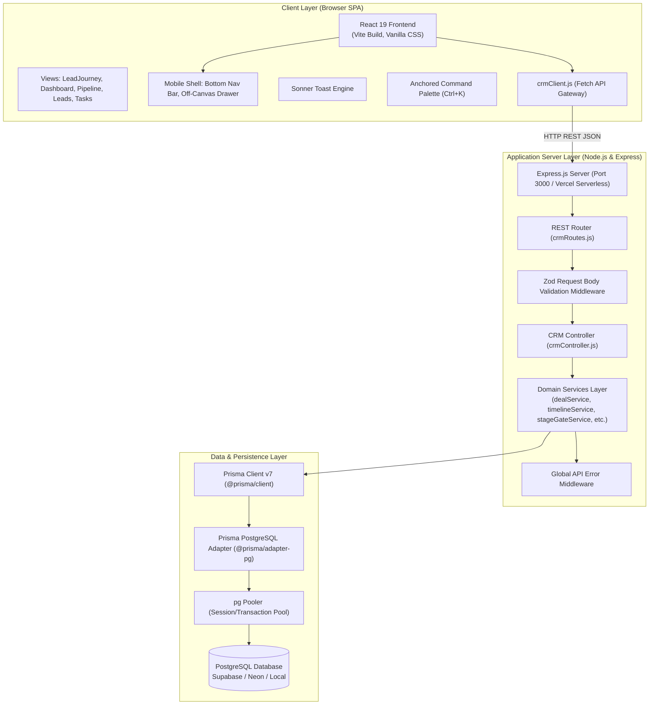

<p align="center">
  <a href="README.md">📖 Overview</a> &nbsp;|&nbsp;
  <a href="features.md">✨ Features</a> &nbsp;|&nbsp;
  <a href="flow.md">🔄 Flow</a> &nbsp;|&nbsp;
  <b>🏗️ Architecture</b> &nbsp;|&nbsp;
  <a href="db.md">🗄️ Database</a> &nbsp;|&nbsp;
  <a href="api.md">🔌 API</a> &nbsp;|&nbsp;
  <a href="setup-guide.md">🚀 Setup Guide</a>
</p>

---

# Sales CRM — System Architecture & Technical Specification

This document provides a technical blueprint of the Sales CRM platform, covering application architecture, technology stack, directory organization, client-server communication, database design, and testing infrastructure.

---

## 1. High-Level Architecture Topology

Sales CRM is built as a Single Page Application (SPA) backed by a Node.js/Express REST API, PostgreSQL database (Supabase/Neon), and Prisma ORM 7 with native PostgreSQL driver adapters.



---

## 2. Technology Stack & Frameworks

| Layer | Technology | Version | Architectural Responsibility |
|:---|:---|:---|:---|
| **Frontend Framework** | React | `^19.0.1` | Component UI, concurrent rendering, error boundaries |
| **Frontend Build Tool** | Vite | `^6.2.3` | Lightning-fast HMR dev server and production asset bundling |
| **UI Icons** | Lucide React | `^0.546.0` | Accessible SVG icon set |
| **Toast Engine** | Sonner | `^2.0.8` | Non-blocking, stacked toast notification system |
| **Animation** | Motion | `^12.23.24` | Micro-interactions and drawer transitions |
| **Backend Framework** | Express.js | `^4.21.2` | Minimalist HTTP REST API server |
| **Validation Engine** | Zod | `^4.6.5` | Type-safe runtime schema validation for HTTP requests |
| **ORM** | Prisma ORM | `^7.10.0` | Schema modeling, type generation, migrations, query engine |
| **Database Adapter** | `@prisma/adapter-pg` | `^7.10.0` | High-performance SQL driver adapter for Prisma 7 |
| **PostgreSQL Driver** | `pg` (node-postgres)| `^8.23.0` | Native Node.js client for PostgreSQL |
| **Styling** | Vanilla CSS | Standard | Surface elevation hierarchy, chevron paths, mobile responsive media queries |
| **Unit Testing** | Vitest | `^5.0.1` | Fast unit & integration test runner for business logic |
| **E2E Testing** | Playwright | `^1.64.0` | End-to-end browser automation for full CRM flows |
| **Bundler** | Esbuild | `^0.25.0` | Production server compilation (`dist/server.cjs`) |

---

## 3. Directory Structure & Code Organization

```text
crm-demo/
├── backend/                        # Backend Node.js / Express application
│   ├── constants/                  # Pipeline transition matrices & stage constants
│   │   └── stageConstants.js       # Allowed transitions, stage colors, hex mappings
│   ├── controllers/                # HTTP request/response orchestration
│   │   └── crmController.js        # Controller handlers delegating to domain services
│   ├── data/                       # Initial and mock datasets
│   │   └── initialData.js          # Seed records for users, stages, deals, activities
│   ├── middleware/                 # Express middleware
│   │   └── validation.js           # Zod schema definitions & validateBody middleware
│   ├── routes/                     # API routing
│   │   └── crmRoutes.js            # Express router mapping endpoints to controllers
│   ├── services/                   # Core business logic layer
│   │   ├── activityNoteService.js  # Activities, notes, and activity deletions
│   │   ├── companyService.js       # Corporate account domain logic
│   │   ├── contactService.js       # Contact management and CSV bulk import
│   │   ├── dealService.js          # Deals, transitions, rebuy engine, renewal triggers
│   │   ├── followUpEngine.js       # Automated follow-up rules & reminders
│   │   ├── leadService.js          # Lead qualification, conversion, title validation
│   │   ├── stageGateService.js     # Stage-gate checklists, approvals, task creation
│   │   ├── stageService.js         # Pipeline stage configuration
│   │   ├── systemService.js        # Health checks, state hydration, state reset
│   │   ├── taskService.js          # Tasks, agenda, manager approvals
│   │   ├── timelineService.js      # Unified customer activity & audit aggregation
│   │   └── userService.js          # Staff & RBAC profile management
│   ├── utils/                      # Server-side utilities
│   │   └── dateUtils.js            # Timezone-safe local date string formatters
│   ├── prisma.js                   # PrismaClient instance with PrismaPg adapter
│   └── server.js                   # Express server entry point & Vite dev middleware
│
├── frontend/                       # React 19 Frontend application
│   ├── api/                        # Client-side API gateway
│   │   └── crmClient.js            # Fetch wrapper communicating with /api endpoints
│   ├── components/                 # React UI components & view modules
│   │   ├── AddActivityModal.jsx    # Log call, meeting, or interaction modal
│   │   ├── CompaniesView.jsx       # Corporate accounts table & detail
│   │   ├── ContactsView.jsx        # Contact directory & management
│   │   ├── DashboardView.jsx       # Executive KPI cards & mobile bar graph switcher
│   │   ├── DetailDrawer.jsx        # 360° slide-over Sheet (4 tabs)
│   │   ├── EmployeesView.jsx       # Staff directory & role governance
│   │   ├── ErrorBoundary.jsx       # Crash recovery & diagnostics UI
│   │   ├── GlobalSearchModal.jsx   # Inline command palette (Ctrl+K)
│   │   ├── Header.jsx              # Navigation header, user switcher, mobile toggles
│   │   ├── ImportExportModal.jsx   # CSV bulk import/export modal
│   │   ├── LeadJourneyView.jsx     # Salesforce-style chevron pipeline & milestone tracker
│   │   ├── LeadsView.jsx           # Lead pipeline, quick-filters, conversion
│   │   ├── ManifestStrip.jsx       # System status & quick metrics footer
│   │   ├── NotFoundView.jsx        # 404 missing view / tab fallback
│   │   ├── PipelineView.jsx        # Drag-and-drop Kanban & table view
│   │   ├── ReportsView.jsx         # Pipeline funnels, loss analysis, velocity
│   │   ├── SettingsView.jsx        # White-label branding & stage customization
│   │   ├── Sidebar.jsx             # Left primary & off-canvas mobile navigation
│   │   ├── StageGateCheckModal.jsx # Yes/No qualification checklist modal
│   │   ├── TasksView.jsx           # Personal tasks & Manager approval agenda
│   │   └── UnifiedTimeline.jsx     # Chronological customer interaction feed
│   ├── utils/                      # Client-side helpers
│   │   └── crmHelpers.js           # Currency formatting, date calculations, badges
│   ├── App.jsx                     # Root application container, tab router & mobile nav
│   ├── index.css                   # Global design tokens, chevron styles, mobile CSS
│   └── main.jsx                    # React 19 DOM bootstrap
│
├── prisma/                         # Database schema & migrations
│   ├── schema.prisma               # 12 Prisma data models & datasource config
│   └── seed.js                     # Database seeding script for demo data
│
├── e2e/                            # Playwright end-to-end test suite (14 tests)
│   ├── crm-features.spec.js        # Core CRM workflows, filters, and drawer tests
│   ├── lead-journey.spec.js        # Chevron milestone path & inline composer tests
│   └── mobile-responsive.spec.js   # Mobile navigation, drawer, and bar graph tests
│
├── tests/                          # Automated unit test suites (Vitest, 32 tests)
│   ├── followUpEngine.test.js      # Follow-up automation rules
│   ├── leadJourney.test.js         # Lead Journey milestone transforms & past stage filters
│   ├── stageTransition.test.js     # Stage transition matrix & color normalization
│   ├── taskService.test.js         # Task workflows & manager approvals
│   ├── timelineService.test.js     # Unified timeline aggregation
│   └── validation.test.js          # Zod schema validation edge cases
│
├── .env.example                    # Environment variable template
├── package.json                    # Project dependencies & npm scripts
├── playwright.config.js            # Playwright browser testing configuration
├── prisma7.config.ts               # Prisma 7 CLI configuration
├── vitest.config.js                # Vitest testing configuration
└── vite.config.ts                  # Vite build configuration
```

---

## 4. Client-Side Architecture & State Model

### 4.1 Single-Page State Hydration
- **Central State Hydration (`/api/state`)**: Upon initial mount, `App.jsx` issues a single call to `fetchCRMState()` to load all system entities (users, stages, branding, deals, leads, companies, contacts, tasks, notes, activities, audit logs).
- **Tab Routing**: The UI operates without full-page reloads, tracking active view state via `activeTab` with safe fallbacks to `NotFoundView`.

### 4.2 Lead Journey Architecture (`LeadJourneyView.jsx`)
- Computes stage milestone status (`completed`, `current`, `upcoming`, `lost`) based on sequential stage order.
- Supports **Historical Stage Inspection**:
  - Reps can click any previous chevron to inspect stage-specific notes and activities.
  - A visual banner indicates read-only inspection mode.
  - Live deal progression remains protected and un-mutated.
- **Inline Activity Composer**:
  - Directly creates activities linked to the active deal and current stage.
  - Triggers non-blocking optimistic UI updates and instant feed refresh.

### 4.3 Mobile Responsive Architecture
- **Breakpoint Hierarchy**: Standard desktop (`>=1024px`), tablet (`768px-1023px`), mobile (`<768px`).
- **Mobile Bottom Navigation Bar**: Anchored to bottom viewport with large touch targets for primary views (Dashboard, Pipeline, Leads, Tasks).
- **Off-Canvas Navigation Drawer**: Accessible from the header hamburger button, providing slide-out access to secondary views without cluttering primary workflow.
- **Adaptive Horizontal Bar Graph**: The Dashboard includes a `[Bars] | [Columns]` view toggle. On mobile, horizontal bars prevent squished, illegible columns.

---

## 5. Backend Architecture & Service Layer

### 5.1 Layered Architecture Pattern
1. **Routing & Validation (`crmRoutes.js` + `validation.js`)**:
   - Maps HTTP paths to controller handlers.
   - Enforces runtime contract validation using Zod before any controller execution.
2. **Controller Layer (`crmController.js`)**:
   - Parses HTTP parameters, handles status codes, and delegates to domain services.
3. **Domain Services Layer (`backend/services/`)**:
   - Encapsulates domain logic:
     - `dealService.js`: Stage-gate validation, demotion rules, rebuy creation, and renewal scanning.
     - `timelineService.js`: Aggregates activities, gate checks, notes, and audit logs into a unified chronological stream.
     - `stageGateService.js`: Qualification checklists, approval queues, and reviewer tasks.
     - `leadService.js`: Validation, inbound/outbound classification, and atomic conversion into Deals/Accounts/Contacts.
4. **Data Access Layer (`prisma.js`)**:
   - Centralized PrismaClient instance utilizing PostgreSQL adapter connection pooling.

### 5.2 Unified Timeline Aggregation (`timelineService.js`)
- Aggregates multiple disparate sources:
  - `Activity`: Calls, meetings, emails.
  - `StageGateCheck`: Formal qualification submissions and outcomes.
  - `Note`: Qualitative comments.
  - `AuditLog`: Critical lifecycle events (overrides, demotions, approvals).
- Normalizes disparate schemas into a consistent chronological feed with type discrimination, author metadata, and stage correlation.

---

## 6. Database & ORM Architecture (Prisma 7 + PostgreSQL)

### 6.1 Prisma 7 Driver Adapter Pattern
Prisma 7 delegates TCP connection pooling to native database adapters:

```javascript
// backend/prisma.js
import 'dotenv/config';
import { PrismaClient } from '@prisma/client';
import { PrismaPg } from '@prisma/adapter-pg';

const connectionString = process.env.DATABASE_URL || process.env.DIRECT_URL;
const adapter = new PrismaPg({ connectionString });

export const prisma = new PrismaClient({ adapter });
```

### 6.2 Connection Pooling Strategy
- **Application Queries (`DATABASE_URL`)**: Uses transaction pooling (port 6543 with PgBouncer) to support high-concurrency serverless and API traffic.
- **Migrations & Seeding (`DIRECT_URL`)**: Uses direct TCP connection (port 5432) for schema operations (`npx prisma db push`, `prisma/seed.js`).

---

## 7. Testing Architecture

### 7.1 Vitest Unit & Integration Suites (32 Tests)
- Fast in-memory execution covering core business rules:
  - Zod validation schemas and sanitization.
  - Pipeline transition matrices and demotion enforcement.
  - Lead Journey status calculations and past-stage grouping.
  - Timeline aggregation logic.
  - Automated follow-up rules and overdue detections.

### 7.2 Playwright End-to-End Suites (14 Tests)
- Automated browser testing running against the live development server:
  - **`crm-features.spec.js`**: Deals board, detail drawer tabs, quick-filter pills, command palette, and test lead cleanup.
  - **`lead-journey.spec.js`**: Interlocking chevron rendering, inspection mode, activity composer submission, and feed updates.
  - **`mobile-responsive.spec.js`**: Mobile viewport simulation (390x844), bottom navigation switching, off-canvas drawer toggle, and dashboard bar graph mode switcher.
- **Automated Test Isolation**: Test suites feature cleanup teardown hooks to delete created test entities, preventing mock data pollution.
