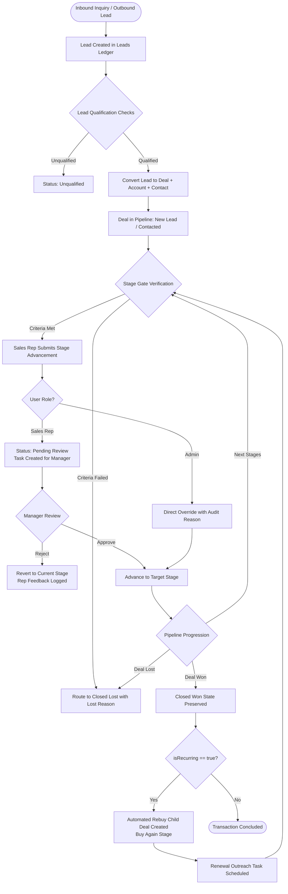
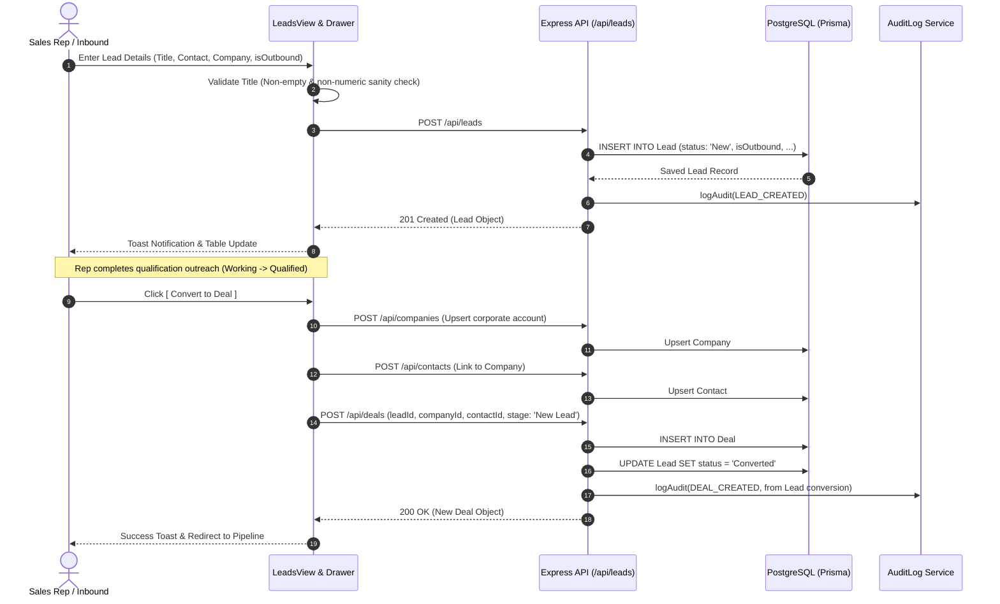
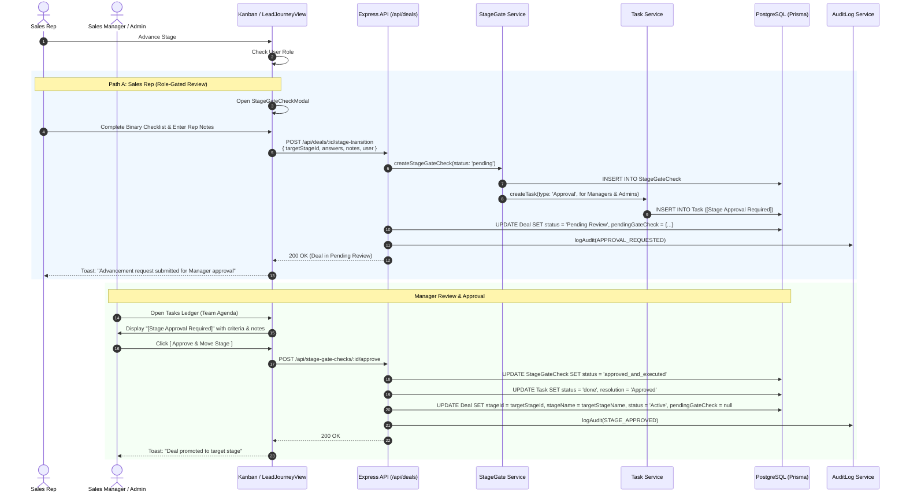
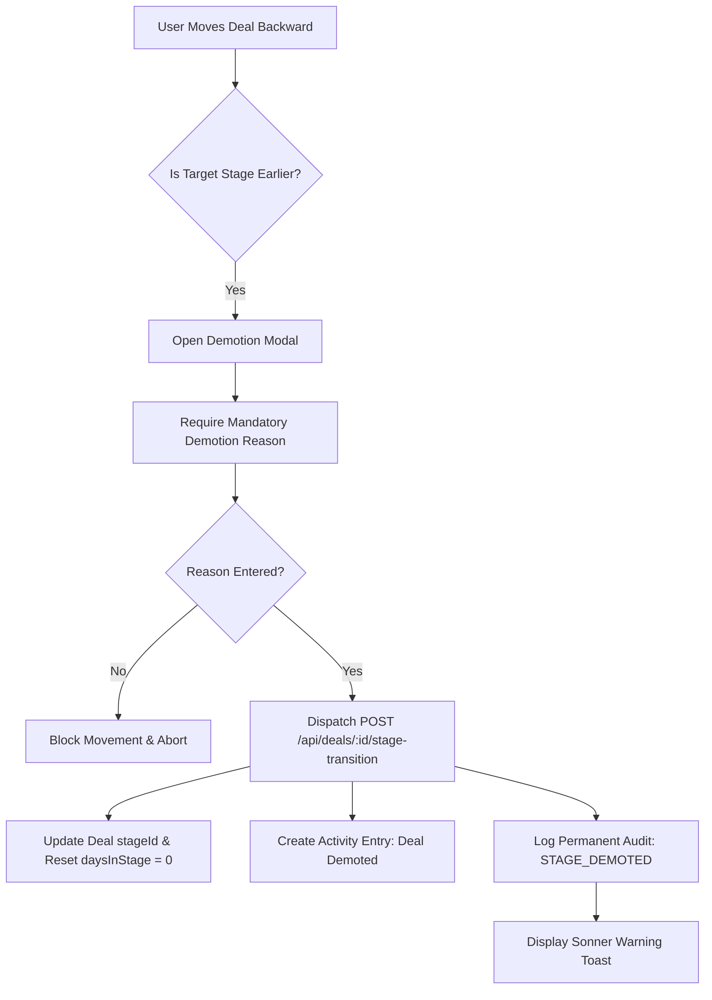
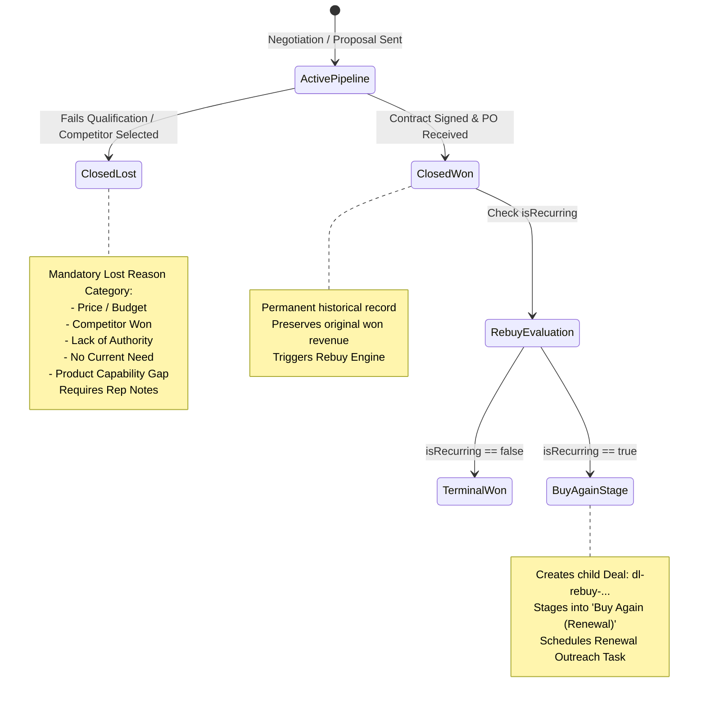
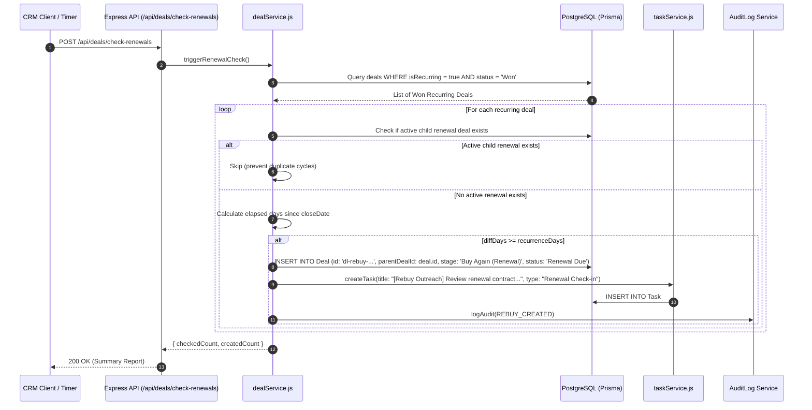
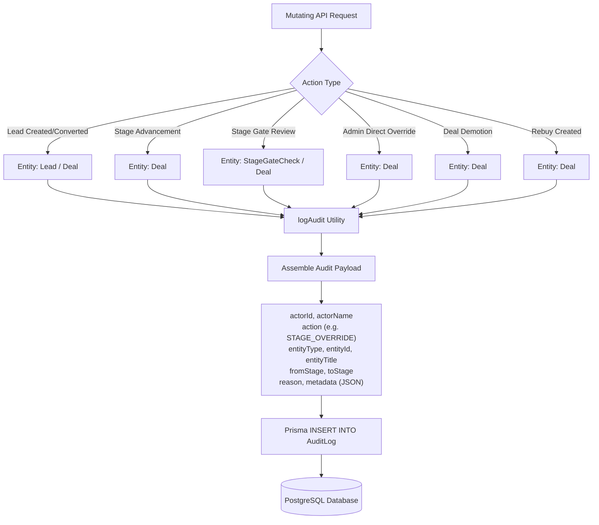

<p align="center">
  <a href="README.md">📖 Overview</a> &nbsp;|&nbsp;
  <a href="features.md">✨ Features</a> &nbsp;|&nbsp;
  <b>🔄 Flow</b> &nbsp;|&nbsp;
  <a href="architecture.md">🏗️ Architecture</a> &nbsp;|&nbsp;
  <a href="db.md">🗄️ Database</a> &nbsp;|&nbsp;
  <a href="api.md">🔌 API</a> &nbsp;|&nbsp;
  <a href="setup-guide.md">🚀 Setup Guide</a>
</p>

---

# Sales CRM — System & Lifecycle Flows

This document details the lifecycle state machines, workflow sequences, and governance flows in Sales CRM.

---

## 1. High-Level B2B Customer Journey



---

## 2. Lead Qualification & Atomic Conversion Flow



---

## 3. Deal Stage-Gate Progression & Approval Flow



---

## 4. Lead Journey Historical Stage Inspection Flow

```mermaid
flowchart TD
    A[User Opens Lead Journey View] --> B[Renders Interlocking Chevron Milestones]
    B --> C{User Clicks Chevron Milestone}
    
    C -- Clicks Previous Stage --> D[Activate Historical Inspection Mode]
    D --> E[Render Blue Historical Banner: 'Viewing snapshot of [Stage] - Read Only']
    E --> F[Filter Activity Feed & Gate Checks to clicked stage]
    E --> G[Lock Stage Advancement Action Controls]
    E --> H[Provide Button: 'Return to Active Stage']
    H --> I[Restore Live Deal Progression Mode]
    
    C -- Clicks Current Stage --> I
    C -- Clicks Next Stage --> J[Trigger Stage Gate Check Modal]
```

---

## 5. Backward Stage Demotion Flow



---

## 6. Terminal States: Closed Won vs. Closed Lost



---

## 7. Automated Rebuy & Renewal Generation Flow



---

## 8. Permanent Audit Logging Flow



---

## 9. Application Error Recovery Flow

```mermaid
flowchart TD
    A[Runtime Exception in React Component] --> B{Caught by ErrorBoundary?}
    B -- Yes --> C[Render ErrorBoundary Fallback Screen]
    C --> D[Display Diagnostics & Stack Trace]
    C --> E[Provide Options: 'Reload Page' OR 'Reset Demo State']
    
    E -- Reset Demo State --> F[POST /api/state/reset]
    F --> G[Prisma re-seeds database from initialData.js]
    G --> H[Reload Application to Pristine State]

    B -- No (API Level Error) --> I[Global Express Error Middleware]
    I --> J[Return HTTP 4xx/5xx with { error, statusCode }]
    J --> K[Frontend Sonner displays contextual error toast]
```
